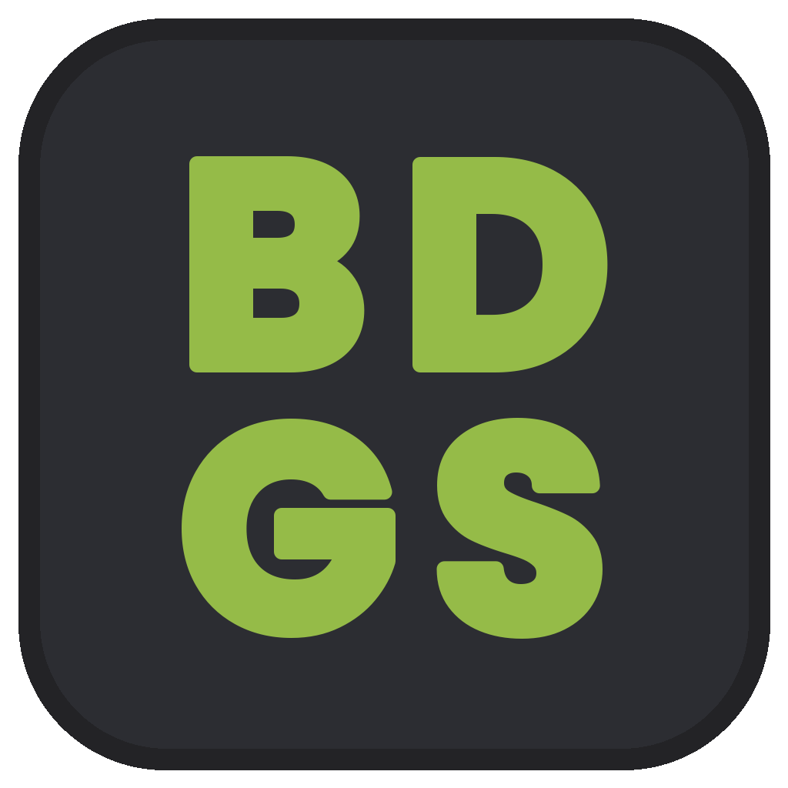
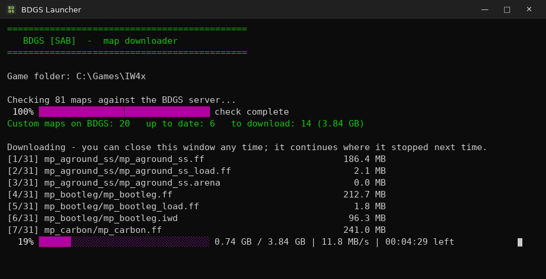

# BDGS Launcher

Downloads every custom map used on the **BDGS [SAB]** IW4x server, so you can join without waiting for in-game downloads.

## How to use

1. Download **[BDGS Launcher.exe](BDGS%20Launcher.exe?raw=true)**.
2. Put it in your IW4x folder (the folder with `iw4x.exe`).
   If it's somewhere else, it asks for the folder once and remembers it.
3. Double-click it. If Windows shows *"Windows protected your PC"*, click **More info → Run anyway** (the file isn't code-signed).
4. Wait for the purple bar to reach 100%, then start IW4x and join BDGS as usual.

Run it again any time: it only downloads maps you're missing or that have changed, and if you close it mid-download it continues where it stopped.

## Details

- Maps come from the BDGS fastdl (Cloudflare R2) and are saved to `usermaps\<map>\` in your IW4x folder.
- Needs Windows 10 or 11 (uses the built-in .NET Framework 4). Nothing to install.
- Source: [`BDGSLauncher.cs`](BDGSLauncher.cs). Build with [`build.sh`](build.sh).
